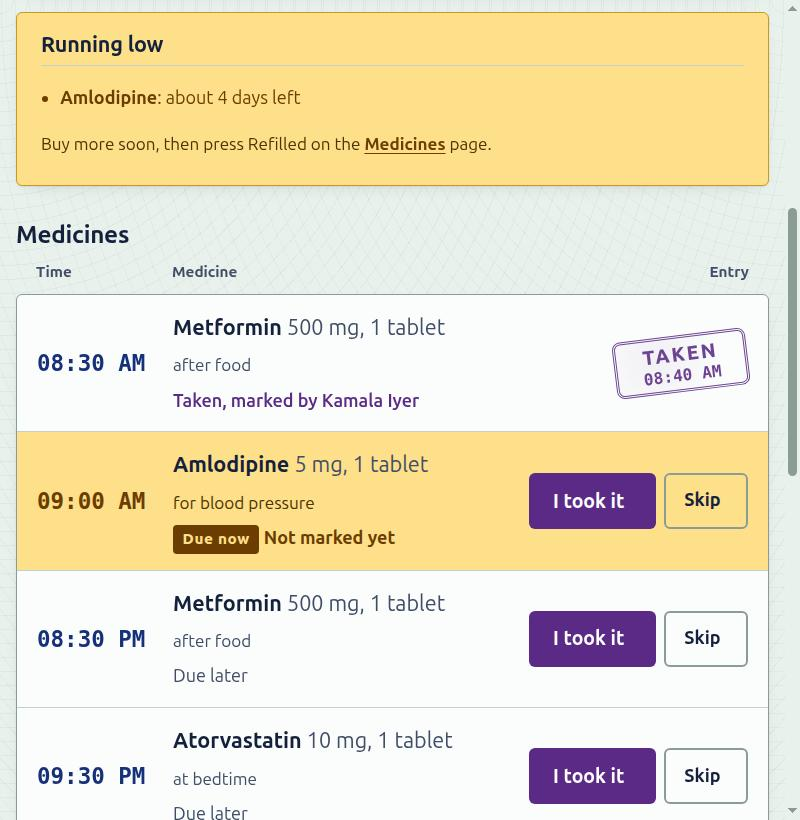
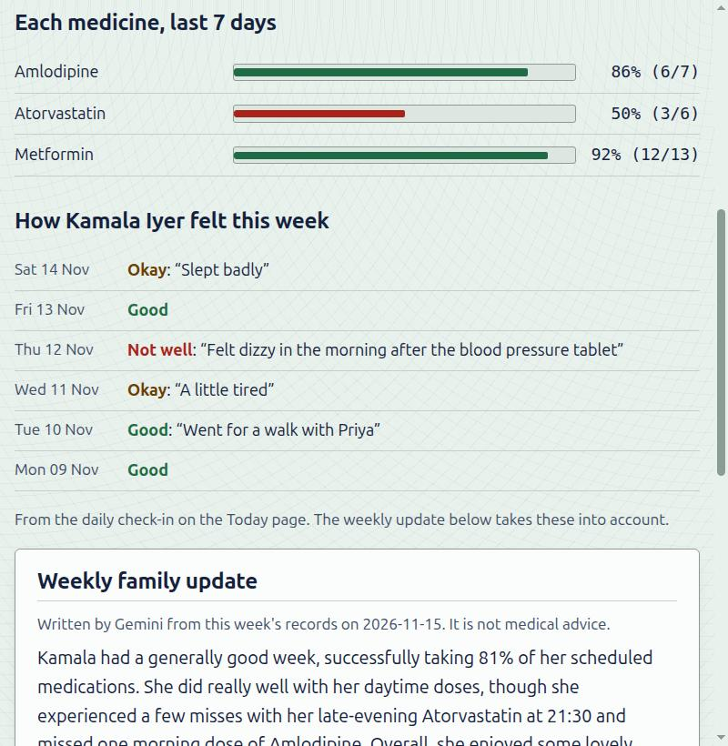
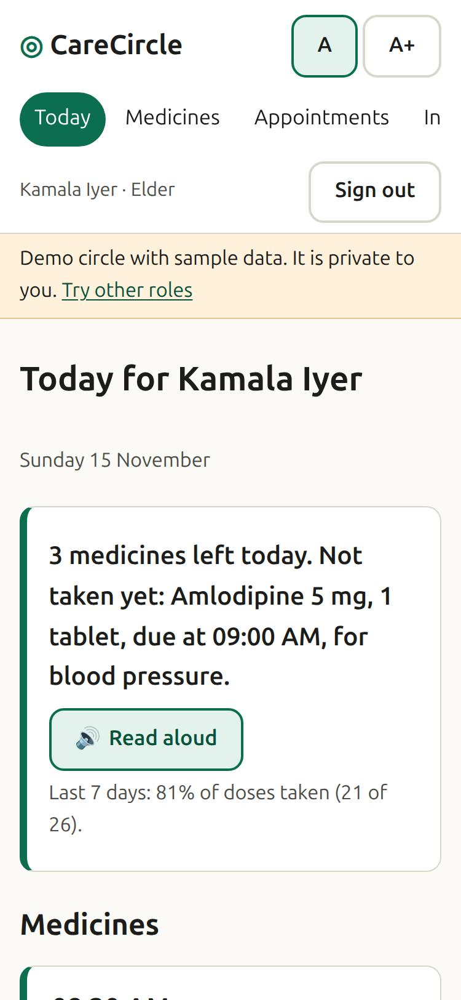

# CareCircle

**An elder-centred medication and appointment platform that keeps elders, caretakers and family in one shared, passcode-protected circle.**

Most reminder apps nag one person. CareCircle treats medication as a team effort with the elder in charge: it reminds the elder first, tells caretakers only if a dose is really missed, brings in family only when it matters, and lets the elder decide who can see and change what.

- **Live app:** https://carecircle-641776536530.asia-south1.run.app (click **Try a demo circle** for a private circle with a week of sample data, no sign-up)
- **Stack:** Python · FastAPI · Jinja2 · Cloud Firestore · Gemini on Vertex AI · Cloud Scheduler · Secret Manager · Cloud Run

| Today, for the elder | Weekly family update by Gemini | On a phone |
|---|---|---|
|  |  |  |

---

## How it meets the challenge

| Challenge requirement | How CareCircle does it |
|---|---|
| Shared ecosystem for elders, caretakers and family | One **care circle** per elder, with three roles: elder, caretaker, family |
| Secure, passcode-based access | Every person has **their own passcode** (Argon2id-hashed) plus the circle code; sign-in is rate-limited |
| View, add, edit and manage medication schedules | Medicines with dose, instructions, several daily times, start and end dates; stop without losing history; **supply count** that ticks down as doses are taken |
| Track adherence | One-tap **"I took it" / "Skip"** per dose, who marked it, 7- and 30-day adherence overall and per medicine |
| Monitor upcoming doctor appointments | Appointment list with reason, place and notes, **Add to Google Calendar**, **Google Maps directions** and a printable **visit sheet** |
| Email reminders for upcoming doses, missed doses and appointments | Cloud Scheduler runs the reminder job every 5 minutes; see the escalation ladder below. Plus a **refill email** when a medicine is running low |
| Beyond a basic reminder app | Gemini **prescription reader**, **escalating** reminders, **refill alerts**, a **daily wellbeing check-in**, a Gemini **weekly family update in 8 languages** and a **doctor-visit sheet** |
| Elder at the centre of their own decisions | Only the elder can add or remove people and switch them between view-only and edit. The elder's own **"How are you feeling today?"** goes into the weekly update and the visit sheet, and the circle is emailed about a bad day **only if the elder chooses** |

## Features

### 1. Today, designed for older eyes
A single screen with the day's doses in large type, high contrast, 48 px+ touch targets, a **Read aloud** button (browser speech synthesis) and an **A / A+** text-size switch. Late doses are flagged with text and an icon, never colour alone.

### 2. Escalating email reminders
Each scheduled dose walks up a ladder until someone marks it:

| When | Who gets an email |
|---|---|
| Up to 15 min before | The elder ("medicine time soon"), or caretakers if the elder has no email |
| 30 min after, still unmarked | The elder and caretakers |
| 60 min after, still unmarked | Everyone, including family ("please check in") |
| Appointment, 24 h and 2 h before | Everyone in the circle |

Runs are idempotent: each dose and appointment records which reminders it has triggered, so overlapping scheduler runs never send duplicates, and doses older than 6 hours are never escalated.

### 3. Prescription photo → schedule (Gemini)
Photograph a prescription or medicine label. Gemini reads it with a **structured JSON schema** (name, dose, times, instructions), maps shorthand like *BD*, *TDS* or *1-0-1* to clock times, and returns a draft. **Nothing is saved until a person checks and confirms each medicine.**

### 4. The elder controls access
The elder adds caretakers and family, chooses *view only* or *view and edit* for each, and can change or revoke it at any time. Permissions are re-read from the database on every request, so a removed person loses access immediately, even mid-session.

### 5. One-click demo
**Try a demo circle** creates a fresh, private circle with an elder, a caretaker and a family member, three medicines (one running low), a week of realistic history (including a pattern of missed evening doses and a dizzy morning in the check-ins) and two upcoming appointments. The circle page lists demo passcodes so you can sign in as each role and see how access changes. Add your own email under *Your reminders* and press **Send me a test email** to see delivery working.

### 6. "How are you feeling today?"
A one-tap daily check-in on the Today screen: **Good**, **Okay** or **Not well**, with an optional note in the elder's own words ("felt dizzy after the morning tablet"). The family sees it on Today and Insights. If the elder picks *Not well* and ticks the box, caretakers and family get an email right away; without that tick, nobody is emailed. The elder decides.

### 7. Weekly family update (Gemini)
From the week's adherence data and check-ins, Gemini writes a short, warm, plain-language summary and 3–5 questions to ask at the next doctor's visit. It turns a feeling like dizziness into a question for the doctor rather than a conclusion. It can be written in **English, Hindi, Marathi, Bengali, Tamil, Telugu, Kannada or Gujarati**, so the elder can read it too (the text is marked with the right `lang` so screen readers switch voice). An editor can email it to the whole circle. It never gives medical advice or suggests dose changes.

### 8. Medicine supply and refill alerts
Enter how many doses are in hand. Each dose marked *taken* counts down (a correction gives it back), the Medicines and Today screens show about how many days are left, and when five days or fewer remain the elder and caretakers get **one** refill email. Pressing **Refilled** adds the new stock and re-arms the alert.

### 9. Doctor-visit sheet
Every appointment has a printable one-page **visit sheet**: current medicines with 30-day adherence for each, how the elder has felt over two weeks (bad days with their notes), the appointment notes, Gemini's suggested questions, and space to write the doctor's advice. **Print or save as PDF** and take it to the clinic.

## Architecture

```
Browser (server-rendered HTML, no framework, works without JavaScript)
   │  HTTPS, signed session cookie
   ▼
Cloud Run ── FastAPI app ─────────────┬── Cloud Firestore (circles, members, medicines, doses, check-ins, appointments)
   ▲                                  ├── Vertex AI Gemini (prescription reading, weekly summary)
   │ OIDC-authenticated POST          ├── Secret Manager (session key, SMTP password)
Cloud Scheduler (every 5 min)         ├── SMTP (Gmail) for reminder emails
                                      └── Cloud Logging (structured JSON logs)
```

```
app/
  main.py              app factory, middleware, security headers
  config.py            settings from environment variables
  models.py            Pydantic domain models
  security.py          Argon2 hashing, CSRF, rate limiter, headers
  logging_config.py    structured JSON logs for Cloud Logging
  store.py             document-store interface + in-memory store (tests, local)
  store_firestore.py   Firestore implementation
  uploads.py           image validation by magic bytes
  services/
    care.py            circles, members, medicines, supply, doses, adherence, check-ins, appointments
    reminders.py       escalation ladder, refill alerts and appointment reminders
    ai.py              prompts, daily AI budget, AI service
    gemini_client.py   Gemini on Vertex AI (Google Gen AI SDK)
    emailer.py         SMTP and console email backends
  routes/              auth, today (doses, check-ins), medications, appointments (visit sheet), circle, insights, tasks
  templates/, static/  accessible HTML, CSS and a little progressive-enhancement JS
tests/                 pytest suite with fakes for Firestore, Gemini and email
```

The domain layer depends only on a small `DocumentStore` interface, so the same code runs on Firestore in production and an in-memory store in tests.

## Google services used

| Service | Used for |
|---|---|
| **Cloud Run** | Hosting the containerised app |
| **Cloud Firestore** | All circle data, with each circle's records in its own sub-collections |
| **Vertex AI (Gemini)** | Prescription reading (multimodal, structured output) and the weekly summary |
| **Cloud Scheduler** | Calls the reminder job every 5 minutes with a Google-signed OIDC token |
| **Secret Manager** | Session signing key and SMTP password, injected at runtime |
| **Cloud Build / Artifact Registry** | Building and storing the container image |
| **Cloud Logging** | Structured JSON logs with severity; errors carry a stack trace for Error Reporting |
| **Google Calendar** | One-click "Add to Google Calendar" links for appointments |
| **Google Maps** | One-click directions to the clinic |

Gemini and Firestore authenticate with the Cloud Run service account, so **there are no API keys in the code or the container**.

## Security

- **Passcodes** are hashed with Argon2id; every member's passcode must be unique within the circle; passcode strength is checked.
- **Sign-in rate limiting** per client address and per circle; sessions are rotated on sign-in to prevent fixation.
- **Signed, HttpOnly, Secure, SameSite=Lax session cookie**, expiring after 12 hours. No tokens in `localStorage`.
- **CSRF tokens** on every state-changing form, compared in constant time.
- **Consent for sharing:** a "Not well" check-in emails the circle only when the elder ticks the box, is never sent to the person who shared it, and is rate-limited per circle.
- **Object-level authorization:** every lookup is scoped to the signed-in member's circle path, so an id from another circle can never resolve (covered by tests). Edit rights and elder-only actions are enforced server-side, not just hidden in the UI.
- **Uploads** are accepted only as JPEG, PNG or WebP by **magic bytes**, capped at 5 MB, processed in memory and never stored or executed.
- **AI safety:** prompts treat user content strictly as data, outputs are schema-validated, shown for human review and HTML-escaped; the model cannot trigger actions. The summary language comes from a fixed allow-list, never free text.
- **AI spending stop:** a hard daily cap on Gemini calls (Firestore counter) plus a per-member hourly limit.
- **Scheduler endpoint** accepts only Google-signed OIDC tokens for the configured audience and service account.
- **Headers:** strict Content-Security-Policy (no inline scripts or styles), HSTS, `X-Frame-Options: DENY`, `nosniff`, Referrer-Policy, Permissions-Policy. API docs are disabled in production.
- **No secrets in code or logs:** secrets come from Secret Manager; logs record counts only, never names, emails or medicines. Email subjects are stripped of newlines to prevent header injection.
- **Container** runs as a non-root user; dependencies are pinned and checked with `pip-audit` in CI.

## Accessibility

Built to WCAG 2.1 AA: semantic landmarks, a skip link, one `h1` per page, a label for every input, `fieldset`/`legend` for grouped times, `aria-current` navigation, an `aria-live` region for messages, visible focus rings, AA colour contrast, 48 px touch targets, text-size switch, read-aloud, `prefers-reduced-motion` and Windows high-contrast (`forced-colors`) support. Buttons that repeat ("I took it") carry hidden context for screen readers, e.g. *"I took it: Metformin at 09:00 AM"*. Every feature works without JavaScript.

## Efficiency

Server-rendered pages with one small CSS file and one small script, gzip compression and cached static files. Each page reads a circle's medicines and dose history once, however many days it covers (30-day adherence is one Firestore query, not thirty; tests pin the read counts), and a new demo circle writes its week of history and check-ins in batches. Reminder runs read each circle once, batch all due doses of the same stage into a single email per recipient group, and check refill levels from the medicines already loaded, with no extra read. Gemini is called only on explicit user action, with low token limits.

## Testing

```bash
uv sync
uv run pytest          # 70 tests, ~90% coverage
uv run ruff check .    # lint
uv run pip-audit -r requirements.txt
```

The suite covers passcode sign-in, rate limiting, CSRF, role and elder-only permissions, cross-circle isolation, XSS escaping, upload validation, the AI budget, prescription review, weekly summaries, appointments, adherence maths, every step of the reminder ladder with fixed clocks, supply counting and refill alerts, check-in consent (no email without the elder's tick), the summary language allow-list, the visit sheet and structured logging. GitHub Actions runs lint, tests and the dependency audit on every push.

## Run locally

```bash
uv sync
uv run uvicorn app.main:get_app --factory --reload --port 8080
```

Locally the app uses an in-memory store and logs emails instead of sending them. AI features switch on when `GOOGLE_CLOUD_PROJECT` is set and Application Default Credentials are available.

## Deploy to Cloud Run

The live app runs in `asia-south1` (Mumbai) with its own least-privilege service account.

```bash
PROJECT=your-project-id REGION=asia-south1
RUN_SA=carecircle-run@$PROJECT.iam.gserviceaccount.com
gcloud services enable run.googleapis.com firestore.googleapis.com aiplatform.googleapis.com \
  cloudscheduler.googleapis.com secretmanager.googleapis.com cloudbuild.googleapis.com \
  artifactregistry.googleapis.com
gcloud firestore databases create --location=$REGION --type=firestore-native
openssl rand -base64 48 | gcloud secrets create session-secret --data-file=-

# The app's identity: Firestore, Vertex AI and this one secret, nothing else.
gcloud iam service-accounts create carecircle-run
gcloud projects add-iam-policy-binding $PROJECT --member=serviceAccount:$RUN_SA --role=roles/datastore.user
gcloud projects add-iam-policy-binding $PROJECT --member=serviceAccount:$RUN_SA --role=roles/aiplatform.user
gcloud secrets add-iam-policy-binding session-secret --member=serviceAccount:$RUN_SA \
  --role=roles/secretmanager.secretAccessor

gcloud run deploy carecircle --source . --region $REGION --allow-unauthenticated \
  --service-account $RUN_SA --min-instances 0 --max-instances 2 \
  --set-env-vars APP_ENV=production,GOOGLE_CLOUD_PROJECT=$PROJECT,GOOGLE_CLOUD_LOCATION=global,GEMINI_MODEL=gemini-3.5-flash \
  --set-secrets SESSION_SECRET=session-secret:latest
```

Reminders: a Cloud Scheduler job calls the reminder endpoint every 5 minutes with a Google-signed OIDC token, which the app verifies (audience and service account).

```bash
URL=$(gcloud run services describe carecircle --region $REGION --format='value(status.url)')
SCHED_SA=carecircle-scheduler@$PROJECT.iam.gserviceaccount.com
gcloud iam service-accounts create carecircle-scheduler
gcloud run services update carecircle --region $REGION \
  --update-env-vars PUBLIC_BASE_URL=$URL,TASKS_AUDIENCE=$URL/tasks/reminders,TASKS_SERVICE_ACCOUNT=$SCHED_SA
gcloud scheduler jobs create http carecircle-reminders --location=$REGION --schedule="*/5 * * * *" \
  --uri=$URL/tasks/reminders --http-method=POST \
  --oidc-service-account-email=$SCHED_SA --oidc-token-audience=$URL/tasks/reminders
```

For real email, set `EMAIL_BACKEND=smtp`, `SMTP_USER`, and an `SMTP_PASSWORD` secret. The health check is `/health`.

| Variable | Purpose |
|---|---|
| `APP_ENV` | `production` turns on secure cookies, Firestore and hides API docs |
| `SESSION_SECRET` | Session signing key (from Secret Manager) |
| `GOOGLE_CLOUD_PROJECT`, `GOOGLE_CLOUD_LOCATION` | Firestore and Vertex AI project and region |
| `GEMINI_MODEL` | Gemini model id |
| `AI_DAILY_CALL_CAP`, `AI_SESSION_CALL_CAP` | AI spending stop |
| `EMAIL_BACKEND`, `SMTP_*`, `EMAIL_FROM` | Email delivery |
| `PUBLIC_BASE_URL` | Links in emails |
| `TASKS_AUDIENCE`, `TASKS_SERVICE_ACCOUNT` | Scheduler OIDC verification |

## Disclaimer

CareCircle helps people keep track of medicines and appointments. It does not give medical advice; always follow the doctor's or pharmacist's instructions.
